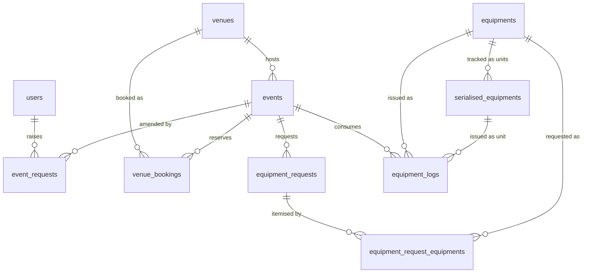

# ConnectSphere — Schema Dictionary

Reference for the initial schema and subsequent migrations, updated through
`V26__legacy_venue_booking_time_compatibility.sql`.
Column names, types and constraints below are generated from the migrations and are
authoritative. **Descriptions are a first draft inferred from the SQL comments — correct
anything that misreads the intent.**

`TODO` marks a decision that hasn't been made yet.

- **Database:** PostgreSQL 18
- **Migration tool:** Flyway (`spring.flyway.enabled=true`), runs on app boot
- **Hibernate:** `ddl-auto=validate` — the schema is owned by these files, never by JPA

---

## 1. Domain overview

The system manages the lifecycle of an event from request to completion, plus the
venue and equipment resources an event consumes.

```
  request  ────>  event  ──┬──> venue_booking       (where it happens)
                                  └──> equipment_request   (what it needs)
                                            │
                                            └──> equipment_logs  (what actually went out)
```

1. A user raises an **event_request** — either a *creation* request (no `event_id`) or a
   *change* request against an existing event (`event_id` set). A creation request starts
   life as `draft` (freely incomplete, editable, visible only to its own `organisation`)
   and moves to `pending` only once submitted with all required fields present.
2. On approval the request becomes an **event**.
3. The event is matched to a **venue** and a **venue_booking** is opened.
4. The event raises an **equipment_request**, itemised in `equipment_request_equipments`.
5. Equipment actually issued is recorded in **equipment_logs**, which is what availability
   for any given time window is calculated from.
6. Approval made only after venue is booked and equipment is confirmed.

### Entity relationships

A curated overview, written by hand. The complete ER diagram of every table,
column and foreign key is generated from the migrated database into
[`docs/er-diagrams/schema.generated.puml`](../../../../../../docs/er-diagrams/schema.generated.puml)
on every backend test run (DEV15).



---

## 2. Enum types

Adding a value later is easy (`ALTER TYPE ... ADD VALUE`); renaming or removing one is
painful. Settle these before there is production data.

| Type | Values | Used by |
|---|---|---|
| `user_role` | `ec`, `eo`, `vs`, `attendee`, `technician`, `ecl` (V21), `safety_officer` (V22, SO-C1–SO-C4) | `users.role` |
| `event_status` | `pending` (shown as Planning; added V12), `confirmed`, `cancelled`, `completed`; V23 adds `awaiting_safety_review`, `safety_changes_requested`, `safety_approved` (EC08) | `events.status` |
| `event_request_status` | `draft`, `pending`, `clarification_required` (V13, EC01), `approved`, `rejected`, `cancelled` | `event_requests.status` |
| `equipment_request_status` | `processing`, `approved`, `rejected`, `superseded` (V52, EC-NEW3), `attention` (V53, EC-NEW3) | `equipment_requests.status` |
| `equipment_status` | `available`, `in_use`, `damaged`, `maintenance`, `retired` | `serialised_equipments.status` |
| `venue_booking_status` | `pending`, `approved` (renamed from `confirmed` in V16), `changed`, `rejected`, `cancelled` | `venue_bookings.status` |
| `accessibilities` | `accessible_parking`, `drop_off_zone`, `public_transport`, `step_free_access`, `wide_doorways`, `elevators`, `wheelchair_support`, `none` (added V5 — see EO02) | `venues.venue_accessibilities`, `events.accessibility_needs`, `event_requests.accessibility_needs` |
| `facilities` | `audio_visual_equipment`, `air_conditioning`, `breakout_spaces`, `projection`, `stage`, `dining_area`, `barbeque_pit` | `venues.venue_facilities` |

### Role meanings

| Value | Stands for | Description |
|---|---|---|
| `ec` | Event Coordinator| Coordinate event |
| `eo` | Event Organiser | People who organise events |
| `vs` | Venue stuff | In charge of the venues |
| `attendee` | Attendee | End user who attends events |
| `technician` | Technician | Technician — presumably handles equipment issue/return |
| `ecl` | Event Coordinator Lead | Oversees incoming event requests and assigns them to Event Coordinators |
| `safety_officer` | Safety Officer | Reviews operational readiness and approves planned events after checklist completion |

### Single-character code columns

These are `CHAR(1)`; the letter-to-meaning mapping lives in application code, not the DB.

| Column | Codes | Meaning |
|---|---|---|
| `event_requests.request_type` | `C` = creation, `A` = amendment/change | Resolved in V3 — a creation request has `event_id IS NULL`; an amendment has it set. |
| `equipments.equipment_type` | TODO | TODO |

---

## 3. Tables

### `users`
People who can log in. Role drives what they may do; `organisation` is free text and may be
null for internal staff.

| Column | Type | Null | Key | Description |
|---|---|---|---|---|
| `user_id` | `UUID` | no | PK | Identifier |
| `hashed_password` | `VARCHAR(255)` | no | | Password hash. TODO — record the algorithm used |
| `email` | `VARCHAR(255)` | no | UQ | Login identity, unique |
| `username` | `VARCHAR(255)` | no | UQ | Display name, unique |
| `created_at` | `TIMESTAMPTZ` | no | | Defaults to `CURRENT_TIMESTAMP` |
| `role` | `user_role` | no | | Determines permissions |
| `organisation` | `VARCHAR(100)` | yes | | Free text; null or `connectSphere` for internal roles |

---

### `refresh_tokens`
Opaque, rotating session credentials (V11, D19 stage 6). Not JWTs, deliberately: the point of this
table is that a session can be *revoked*, and a signed token cannot be. Access tokens live minutes
and are verified by signature alone; these live weeks and are verified against this table.

| Column | Type | Null | Key | Description |
|---|---|---|---|---|
| `token_id` | `UUID` | no | PK | Identifier |
| `user_id` | `UUID` | no | FK → `users` | Owner; `ON DELETE CASCADE` |
| `token_hash` | `VARCHAR(64)` | no | UQ | SHA-256 hex of the token. The token itself is never stored |
| `family_id` | `UUID` | no | IX | Groups every token descended from one login |
| `issued_at` | `TIMESTAMPTZ` | no | | Defaults to `CURRENT_TIMESTAMP` |
| `expires_at` | `TIMESTAMPTZ` | no | | Checked `> issued_at` |
| `revoked_at` | `TIMESTAMPTZ` | yes | | Null means live; set on rotation, logout, or family revocation |

Rotation is single-use: each refresh revokes the presented token and issues a successor in the same
family. A revoked row is kept rather than deleted, because recognising an already-used token is what
makes **reuse detection** possible — presenting one means replay or theft, so the whole family is
revoked and the user must log in again. Hashed with SHA-256 rather than BCrypt on purpose: the value
is 256 bits of CSPRNG output, so there is no low-entropy guess for slow hashing to frustrate.

---

### `venues`
Bookable spaces, with the accessibility and facility attributes used to match them to events.

| Column | Type | Null | Key | Description |
|---|---|---|---|---|
| `venue_id` | `UUID` | no | PK | Identifier |
| `venue_address` | `TEXT` | no | | Full address |
| `venue_name` | `TEXT` | no | | Public display name (V35; legacy values start as the address) |
| `latitude` | `DOUBLE PRECISION` | yes | | Optional verified degrees, -90..90 inclusive (V60); unknown stays NULL |
| `longitude` | `DOUBLE PRECISION` | yes | | Optional verified degrees, -180..180 inclusive (V60); unknown stays NULL |
| `supported_layouts` | `TEXT[]` | no | | One-dimensional, nonempty array of supported layouts; null and whitespace-only elements are rejected (V6) |
| `venue_capacity` | `INTEGER` | no | | Overall venue capacity shared by all layouts; 1-50,000 inclusive (V6) |
| `venue_accessibilities` | `accessibilities[]` | no | | Features present. Defaults to `{}` |
| `operating_information` | `TEXT` | no | | Derived compatibility summary of structured hours; stored text remains nonblank (V6/V39) |
| `venue_facilities` | `facilities[]` | no | | Facilities present. Defaults to `{}` |
| `additional_information` | `TEXT` | yes | | Free-text notes |

**VS06A scope and migration:** V6 renames `venue_layout` to `supported_layouts`
and preserves each legacy text value verbatim as one array element. It does not
guess separators or classify old prose. Existing venues with missing/nonpositive
capacity, capacity above 50,000, missing/blank layout or blank operating information must be corrected
before V6 can run; the migration raises an error instead of inventing values.

Constraints: `chk_venue_capacity_range`, `chk_venue_layouts_nonempty`,
`chk_venue_layout_values` and `chk_venue_operating_information_nonblank`.
The immutable SQL helper `venue_layouts_have_values(text[])` rejects null/blank
array elements. The API DTOs use the Java `VenueLayout` enum: `classroom`,
`theatre`, `boardroom`, `banquet`, `exhibition`. The entity keeps `List<String>`
and the database keeps `text[]`; this migration does not introduce a PostgreSQL
layout enum. Legacy prose values need classification before enum-based DTO reads.

The planned creation form starts capacity at 50, editable by Venue Staff. This is
a frontend initial value, not a database default. Backend input validation (in
`VenueService.createVenue`) rejects omitted/out-of-range capacity, missing/duplicate layouts,
blank address/operating information and addresses over 500 characters; addresses
are trimmed, not checked for real-world existence. These DTO/service rules are
distinct from the database constraints documented above.

Operating hours are entered as structured daily intervals. Creation and hours updates require at least one operating day. The service generates operating_information from these intervals for catalogue, search, booking and organiser readers. Legacy records without structured hours may retain stored text, but every API reader and display reports Operating hours not configured until structured days are supplied. Legacy prose is never parsed or advertised as opening hours. Hours changes retain booking reassessment. Venue address remains required.
The Venue API now records accessibility/facility selections in the existing enum
arrays. Omitted/null lists become empty; duplicate/null entries are rejected.
Accessibility `none` explicitly records no provisions and is exclusive. The entity
uses string collections with write casts to `accessibilities[]` / `facilities[]`,
preserving database enum validation and existing GIN indexes (see `docs/venue-api.md`).

**Indexes**

| Name | Definition | Purpose |
|---|---|---|
| `idx_venue_accessibility` | `GIN (venue_accessibilities)` | Containment filtering, e.g. `venue_accessibilities @> '{wheelchair_support}'` |
| `idx_venue_facility` | `GIN (venue_facilities)` | Same, for facilities |

> Use the `@>` containment operator to hit these indexes. `= ANY(...)` will not use them.

---

### `events`
An event created from an approved `event_request`. It remains `pending` (Planning)
until its Safety Officer readiness review is approved, then becomes `confirmed`.

| Column | Type | Null | Key | Description |
|---|---|---|---|---|
| `event_id` | `UUID` | no | PK | Identifier |
| `event_name` | `VARCHAR(255)` | no | | Title |
| `purpose` | `TEXT` | no | | Why the event is being held |
| `description` | `TEXT` | yes | | Longer description |
| `start_datetime` | `TIMESTAMPTZ` | no | | Start |
| `end_datetime` | `TIMESTAMPTZ` | no | | End |
| `expected_attendance` | `INTEGER` | no | | Forecast headcount, used against `venue_capacity` |
| `venue_id` | `UUID` | yes | FK → `venues` | Null until a venue is assigned |
| `accessibility_needs` | `accessibilities[]` | no | | Required features, matched against `venues.venue_accessibilities`. Defaults to `{}` |
| `registration_needs` | `BOOLEAN` | yes | | Whether attendees must register |
| `registration_capacity` | `INTEGER` | yes | | V35. Maximum confirmed attendee registrations |
| `registration_opens_at` | `TIMESTAMPTZ` | yes | | V35. Inclusive registration opening instant |
| `registration_closes_at` | `TIMESTAMPTZ` | yes | | V56. Exclusive closing instant; no later than event start |
| `organisation` | `VARCHAR(100)` | yes | | Owning organisation, free text |
| `actual_attendance` | `INTEGER` | yes | | Recorded after the event |
| `venue_requirements` | `TEXT` | no | | Free-text venue needs |
| `equipment_requirements` | `TEXT` | yes | | Free-text equipment needs. TODO — clarify against `equipment_requests.technical_requirement` |
| `status` | `event_status` | no | | Lifecycle state |
| `safety_approved_at` | `TIMESTAMPTZ` | yes | | V23. When the Safety Officer approved; cleared when the event returns to Planning |
| `safety_feedback` | `TEXT` | yes | | V23. The Safety Officer's latest feedback when changes were requested |
| `first_confirmed_at` | `TIMESTAMPTZ` | yes | | V23. First confirmation; never overwritten (EO04 "updated since") |
| `confirmed_at` | `TIMESTAMPTZ` | yes | | V23. Latest confirmation |
| `confirmed_by` | `UUID` | yes | FK → `users` | V23. The coordinator who last confirmed |

---

### `event_readiness_items` (V22, SO-C3)

Persisted status and notes for a predefined event readiness item. The item keys
and labels are defined in the backend so events share the same standard checklist.
`checked_by`/`checked_at` preserve the most recent check attribution even if an
item is later unchecked; `updated_by`/`updated_at` track the most recent edit.

| Column | Type | Null | Key | Description |
|---|---|---|---|---|
| `item_id` | `UUID` | no | PK | Application-generated state row identifier |
| `event_id` | `UUID` | no | FK → `events` | Event, cascade-deleted with the event |
| `item_key` | `VARCHAR(80)` | no | UQ with event | Stable key for a predefined checklist item |
| `checked` | `BOOLEAN` | no | | Current checklist state |
| `note` | `VARCHAR(2000)` | no | | Item note, empty by default |
| `checked_by` | `UUID` | yes | FK → `users` | Most recent Safety Officer to check the item |
| `checked_at` | `TIMESTAMPTZ` | yes | | Time of the most recent transition to checked |
| `updated_by` | `UUID` | yes | FK → `users` | Most recent editor |
| `updated_at` | `TIMESTAMPTZ` | yes | | Most recent edit time |

### `event_safety_reviews` (V22, SO-C4; V34, SO-C5/SO-C6)

The latest Safety Officer decision for an event, with the reviewer, time, note
and the checklist items it concerns. Since EC08 (V23, D22) a decision does not
confirm the event: approval moves it to `safety_approved` for the coordinator to
confirm, and a rejection or a request for changes returns it to the coordinator
as `safety_changes_requested`, with the note in `events.safety_feedback`. Each
decision overwrites this row; the event's timeline keeps every decision.

| Column | Type | Null | Key | Description |
|---|---|---|---|---|
| `event_id` | `UUID` | no | PK, FK → `events` | Event under review, cascade-deleted with the event |
| `review_status` | `VARCHAR(32)` | no | | `approved`, `rejected` or `changes_requested` (V23; widened from 16 in V24) |
| `note` | `VARCHAR(2000)` | no | | Review note: optional for an approval, required (1–2,000 characters after trimming, checked by `ReadinessService`) for a rejection or a request for changes |
| `reviewed_by` | `UUID` | no | FK → `users` | Safety Officer who made the latest decision |
| `reviewed_at` | `TIMESTAMPTZ` | no | | Time of the latest decision |
| `flagged_items` | `TEXT[]` | no | | V34: readiness checklist item keys (`event_readiness_items.item_key`) the rejection or request for changes concerns, in checklist order; at least one for those decisions, none for an approval (checked by `ReadinessService`). Default `{}`. `chk_safety_review_flagged_items` allows only the six checklist keys |

---

### `event_requests`
Requests to create a new event or change an existing one. Mirrors most of `events` because a
request holds proposed values that are not yet live.

| Column | Type | Null | Key | Description |
|---|---|---|---|---|
| `request_id` | `UUID` | no | PK | Identifier |
| `request_type` | `CHAR(1)` | yes | | Creation (`C`) vs amendment (`A`) — see code table above |
| `event_id` | `UUID` | yes | FK → `events` | Set for change requests, null for creation requests |
| `event_name` | `VARCHAR(255)` | **yes (since V3)** | | Proposed title. Nullable while status is `draft`; required to submit (enforced in the app, not the DB) |
| `purpose` | `TEXT` | **yes (since V3)** | | Proposed purpose. Same draft/submit note as `event_name` |
| `description` | `TEXT` | yes | | Proposed description |
| `start_datetime` | `TIMESTAMPTZ` | yes | | Proposed start. Nullable here, `NOT NULL` on `events`; required to submit |
| `end_datetime` | `TIMESTAMPTZ` | yes | | Proposed end. Same note |
| `expected_attendance` | `INTEGER` | **yes (since V3)** | | Proposed headcount. Same draft/submit note |
| `venue_requirements` | `TEXT` | **yes (since V3)** | | Proposed venue needs. Same draft/submit note |
| `equipment_requirements` | `TEXT` | yes | | Proposed equipment needs |
| `accessibility_needs` | **`text[]` (since V4 — see below)** | no | | Proposed required features. Defaults to `{}` |
| `registration_needs` | `BOOLEAN` | yes | | Whether registration is proposed |
| `status` | `event_request_status` | no | | Approval state |
| `created_at` | `TIMESTAMPTZ` | no | | Defaults to `CURRENT_TIMESTAMP` |
| `updated_at` | `TIMESTAMPTZ` | **no (since V7)** | | Last save/submit time; set by `EventRequestService`, not a DB trigger — powers EO01/EO15's "last edited X minutes ago" |
| `organisation` | `VARCHAR(100)` | yes | | Requesting organisation, free text |
| `created_by` | `UUID` | yes | FK → `users` | Requester |

> A request may carry null start/end times while `events` requires them, so approval must
> reject or fill in a request with missing times.
>
> **`status = 'draft'` is the only state where the four columns above may legitimately be
> null.** `EventRequestService.submit()` is the single place that checks all of them are
> present before allowing a transition to `pending` — do not duplicate that check elsewhere,
> and do not rely on the database to catch a missing field once a request leaves `draft`.
>
> **`accessibility_needs` on this table only is `text[]`, not the shared `accessibilities`
> enum-array type** (see V4 migration) — Hibernate 7 could not reliably bind a value into a
> *named* Postgres enum array (two approaches tried against real Postgres both failed; see
> the V4 migration file for the detail). `venues.venue_accessibilities` and
> `events.accessibility_needs` are unaffected and still use the real enum-array type — if you
> implement those tables' entities, do not copy this table's mapping; work out the enum-array
> mapping properly for them, or apply the same `text[]` fallback deliberately and note it here.

---

### `equipments`
Inventory catalogue — one row per equipment *kind*, not per physical unit.

| Column | Type | Null | Key | Description |
|---|---|---|---|---|
| `equipment_id` | `UUID` | no | PK | Identifier |
| `equipment_name` | `VARCHAR(255)` | no | | Display name |
| `equipment_qty` | `INTEGER` | no | | Total units owned. Availability = this minus what is on loan |
| `serialised` | `BOOLEAN` | yes | | True when individual units are tracked in `serialised_equipments` |
| `equipment_type` | `CHAR(1)` | no | | Category code — see code table above |

---

### `serialised_equipments`
Individual physical units of high-value equipment. Only used where `equipments.serialised` is true.

| Column | Type | Null | Key | Description |
|---|---|---|---|---|
| `equipment_id` | `UUID` | no | PK, FK → `equipments` | Which kind of equipment |
| `serial_number` | `VARCHAR(64)` | no | PK | Serial, unique only within an `equipment_id` |
| `status` | `equipment_status` | no | | Condition/availability of this unit |

**Primary key:** `(equipment_id, serial_number)` — serials are only assumed unique per equipment kind.

---

### `equipment_requests`
A request for equipment attached to an event. Header row; the items are in
`equipment_request_equipments`.

| Column | Type | Null | Key | Description |
|---|---|---|---|---|
| `request_id` | `UUID` | no | PK | Identifier |
| `event_id` | `UUID` | no | FK → `events` | Event the equipment is for |
| `status` | `equipment_request_status` | no | | Approval state |
| `technical_requirement` | `TEXT` | no | | Free-text technical needs |
| `reject_reason` | `TEXT` | yes | | Populated only when `status = 'rejected'` |
| `attention_reason` | `TEXT` | yes | | V53: why an approved change flagged it; populated only when `status = 'attention'` |

**V52 (EC-NEW3, D36):** `superseded` marks a request a coordinator's revision
replaced. Reachable only from `processing`/`approved`, through
`PATCH /events/{eventId}/equipment-request` — never a status TS01/TS06
queue or decide directly. The replaced request's own row, and its lines,
are kept as they were; nothing about it is edited in place, so a later
audit can still see what changed. The revision also releases every
`equipment_logs` row for the event (D36) — a reservation names only its
event, never a request, so a request-scoped release is not possible.

---

### `equipment_request_equipments`
Line items — what equipment, and how much of it, a request asks for.

| Column | Type | Null | Key | Description |
|---|---|---|---|---|
| `request_id` | `UUID` | no | PK, FK → `equipment_requests` | Parent request |
| `equipment_id` | `UUID` | no | PK, FK → `equipments` | Equipment kind requested |
| `equipment_qty` | `INTEGER` | no | | Quantity requested |

**Primary key:** `(request_id, equipment_id)` — one line per equipment kind per request.

---

### `equipment_logs`
What equipment is actually out, and for how long. This is the table availability is computed
from; `equipment_requests` records intent, this records reality.

| Column | Type | Null | Key | Description |
|---|---|---|---|---|
| `log_id` | `UUID` | no | PK | Identifier |
| `event_id` | `UUID` | no | FK → `events` | Event the equipment went to |
| `equipment_id` | `UUID` | no | FK → `equipments` | Equipment kind |
| `quantity` | `INTEGER` | no | | Units issued. `1` for a serialised unit |
| `technical_requirements` | `TEXT` | yes | | Free-text notes |
| `serial_number` | `VARCHAR(64)` | yes | FK → `serialised_equipments` | Set for serialised units, null for bulk loans |
| `loaned_from` | `TIMESTAMPTZ` | no | | Start of the loan window — may precede the event for setup |
| `loaned_until` | `TIMESTAMPTZ` | no | | End of the loan window — may follow the event for teardown |
| `spare` | `BOOLEAN` | no | | V40. `true` for an extra unit held beyond the requested quantity; default `false` |

**Foreign keys:** `(equipment_id, serial_number)` is a *composite* FK to `serialised_equipments`,
so a log row cannot cite a serial belonging to a different equipment kind. Because
`serial_number` is nullable, the constraint is skipped for bulk loans (`MATCH SIMPLE`).

**Availability for a window** — the query this table exists to serve:

```sql
SELECT e.equipment_name,
       e.equipment_qty                          AS total,
       COALESCE(SUM(l.quantity), 0)             AS on_loan,
       e.equipment_qty - COALESCE(SUM(l.quantity), 0) AS available
FROM equipments e
LEFT JOIN equipment_logs l
       ON l.equipment_id = e.equipment_id
      AND l.loaned_from  < :window_end
      AND l.loaned_until > :window_start
GROUP BY e.equipment_id, e.equipment_name, e.equipment_qty;
```

---

### `venue_bookings`
Reservation of a venue for an event. On a change request the existing booking is cancelled or
marked changed and a new booking row is opened, so an event may have several booking rows
over its life.

| Column | Type | Null | Key | Description |
|---|---|---|---|---|
| `booking_id` | `UUID` | no | PK | Identifier |
| `venue_id` | `UUID` | no | FK → `venues` | Venue reserved |
| `event_id` | `UUID` | no | FK → `events` | Event reserving it |
| `status` | `venue_booking_status` | no | | Booking state |
| `booking_notes` | `TEXT` | yes | | Free-text notes |
| `reject_reason` | `TEXT` | yes | | Populated only when `status = 'rejected'` |
| `submitted_by` | `UUID` | yes | FK → `users` | V13, EC03: coordinator who requested it (null on older rows) |
| `submitted_at` | `TIMESTAMPTZ` | yes | | V13, EC03: when it was requested |
| `suitability_note` | `TEXT` | yes | | V13, EC03: coordinator's justification when the venue lacks a requested accessibility feature |
| `alternative_venue_id` | `UUID` | yes | FK → `venues` | V19, VS09: optional alternative venue suggested with a rejection; not a booking |
| `alternative_arrangement` | `TEXT` | yes | | V19, VS09: optional free-text arrangement, at most 2,000 characters |
| `start_datetime` | `TIMESTAMPTZ` | yes | | V25, EC-C2: this venue's requested start time; nullable for legacy rows |
| `end_datetime` | `TIMESTAMPTZ` | yes | | V25, EC-C2: this venue's requested end time; nullable for legacy rows |

Each new booking has its own time window. Existing rows are backfilled when their event has
dates; legacy fixture rows may remain nullable. EC-C2 permits multiple `pending`/`approved`
bookings per event; each venue is validated independently and duplicate overlapping venues
in one batch are rejected transactionally.
The service validates each batch under the event row lock rather than using a unique index
(test fixtures deliberately hold several bookings per event).

V19 stores optional alternative suggestions on the rejected booking request. The suggested venue
must differ from the venue that was rejected. Suggestions do not create a booking or change the
event's requirements.

---

### `event_request_activity` (V13)
Append-only timeline of one event request, from submission through review, clarification,
approval and venue planning (EC01/EC02/EO26/EC03; first slice of DEV07). Every row is written by
a workflow action in the same transaction as the change it describes. **A trigger rejects every
`UPDATE` and `DELETE`**, so history cannot be rewritten even by hand.

| Column | Type | Null | Key | Description |
|---|---|---|---|---|
| `activity_id` | `UUID` | no | PK | Identifier |
| `request_id` | `UUID` | no | FK → `event_requests` | The request whose story this is |
| `event_id` | `UUID` | yes | FK → `events` | Set from approval onwards |
| `activity_type` | `VARCHAR(50)` | no | | `ActivityType` in Java is the whitelist (text, so a new kind of entry needs no migration) |
| `actor_user_id` | `UUID` | no | FK → `users` | Who acted |
| `actor_role` | `VARCHAR(20)` | no | | Their role at the time |
| `actor_name` | `VARCHAR(255)` | no | | Snapshot of their username |
| `message` | `TEXT` | yes | | Clarification, response or reason (max 2000 chars, CHECK) |
| `flagged_fields` | `TEXT[]` | no | | Field keys the coordinator flagged (EC01) |
| `from_status`, `to_status` | `VARCHAR(50)` | yes | | Status change, where there was one |
| `audience_roles` | `TEXT[]` | no | | Roles allowed to see the entry; filtered in the repository query |
| `occurred_at` | `TIMESTAMPTZ` | no | | When |

V14 added `field_questions JSONB` (one question per flagged field, on `clarification_requested`) and
`field_values JSONB` (the request's values when clarification was asked or answered; the pair
shows what changed), plus the `venue_booking_cancelled` notification type.

V13 also added `notifications.message` and `notifications.venue_booking_id` (no FK, on purpose:
a notification is a historical record) and three `notification_type` values:
`clarification_requested`, `clarification_responded`, `venue_booking_requested`.

---

### `mock`, `mock_references` (V1)
Scaffolding from the mock API used to demonstrate the MVC layering. Not part of the domain —
delete once real entities exist.

---

## 4. Conventions

- **Keys** are `UUID`, generated by the application, never sequential integers.
- **Timestamps** are `TIMESTAMPTZ` (UTC on the wire, rendered in the client's zone).
  Never use plain `TIMESTAMP`.
- **Enum arrays** are compared with `@>` so the GIN indexes are used.
- **Free-text** fields are `TEXT`; bounded identifiers are `VARCHAR(n)`.
- **`reject_reason`** is nullable everywhere it appears — only populated on rejection.
- **Migrations are immutable once applied.** Flyway stores a checksum per file; editing an
  already-applied migration makes the next boot fail. Add the next unused `V{n}__*.sql` instead, or reset dev
  with `docker compose down -v`.

## 5. Known gaps / decisions outstanding

| # | Item | Notes |
|---|---|---|
| 1 | No overlap protection on `venue_bookings` | VS03 checks overlapping approved bookings under an event lock followed by a venue lock before updating status. Concurrent approvals through this service are serialised; direct SQL and future schedule-changing workflows still require equivalent protection. |
| 2 | `organisation` is free text in 3 tables | Accepted for now; risks `connectSphere` / `ConnectSphere` drift |
| 3 | ~~`CHAR(1)` code mappings undocumented~~ | **Resolved in V3** for `request_type` (`C`/`A`) — see §2. `equipment_type` still TODO. |
| 4 | `event_requests` has several nullable fields that `events` requires | Approval path must handle this. Widened in V3 (`event_name`, `purpose`, `expected_attendance`, `venue_requirements` are now also nullable, to support `draft` status) — `EventRequestService.submit()` is where completeness is enforced before a request may leave `draft`. |
| 5 | `equipment_requirements` vs `equipment_requests.technical_requirement` | Overlapping free text — confirm which is authoritative |
| 6 | ~~No audit of who approved a request~~ | **Resolved in V13** for event requests: `event_request_activity` records who submitted, assigned, clarified, responded, approved, rejected and requested a venue, and when. Venue booking decisions and lifecycle activity are now recorded, with hold, requirement review and assessment histories in V29/V34–V38. A universal audit log remains separate. |
| 7 | `equipment_logs` has no return/check-in flag | Availability is inferred purely from the loan window |
| 8 | `event_requests.accessibility_needs` is `text[]`, not the shared enum-array type | V4 migration — ORM limitation, not a data-modelling choice. Revisit if `venues`/`events` entities need the same values and a consistent type is wanted across tables. |

## 6. JPA notes for whoever writes the entities

The schema uses Postgres types that plain JPA annotations do not map by default:

- **Enum columns** (`role`, `status`, …) are real Postgres enums, not varchar. Plain
  `@Enumerated(EnumType.STRING)` fails with a type mismatch — use
  `@JdbcTypeCode(SqlTypes.NAMED_ENUM)` (Hibernate 6.2+).
- **Array columns** (`accessibilities[]`, `facilities[]`) need `@JdbcTypeCode(SqlTypes.ARRAY)`.
- **Composite keys** (`serialised_equipments`, `equipment_request_equipments`) need
  `@IdClass` or `@EmbeddedId` — same pattern as the existing `MockReferenceId`.
- Tables with no entity are ignored by `ddl-auto=validate`, so entities can land one at a time.

## V20 update — venue unavailability

V20 adds `venue_unavailability` (UUID primary key, required venue/creator foreign keys, required start/end `timestamptz`, trimmed nonblank reason up to 2000 characters, creation timestamp and strict end-after-start check). `venue_unavailability_bookings` links unavailable periods to affected bookings with a composite primary key. These links preserve history and do not replace operational issues.

`venues` now has `setup_minutes` and `turnaround_minutes`, non-null integers defaulting to zero, constrained to 0–10080. `venue_bookings.replaces_booking_id` is a nullable self-reference. A partial unique index permits at most one pending replacement per original. `notifications.type` includes `venue_unavailable`, requiring a booking reference. See [VS01 API and consistency rules](../../../../../../docs/venue-unavailability-api.md).

## V23 update — event safety review lifecycle (EC08, EC-NEW2, EO04)

V23 adds three `event_status` values (`awaiting_safety_review`, `safety_changes_requested`, `safety_approved`) and five nullable `events` columns (`safety_approved_at`, `safety_feedback`, `first_confirmed_at`, `confirmed_at`, `confirmed_by` → `users`). Already-confirmed or completed events are backfilled so that `confirmed_at`/`first_confirmed_at` are not null. `notification_type` gains `event_confirmed`, `event_returned_to_planning` and `event_safety_approved`; `chk_notification_shape` requires an `event_id` for all three. `event_safety_reviews.review_status` (V22) also allows `changes_requested`. See decision-log D22.

## V24 update — safety review status length (SO-C5, EC08)

V24 widens `event_safety_reviews.review_status` from `VARCHAR(16)` to `VARCHAR(32)`. V23 allowed `changes_requested` in the CHECK constraint, but that value is 17 characters, so the Safety Officer's "Request changes" decision failed with a 500 until this migration.

## V27 update — booking duration snapshots

`venue_bookings.setup_duration_minutes` and `turnaround_duration_minutes` are non-null integers constrained to 0–10080. V27 copies the associated venue's current values into all existing bookings, preserving their previously calculated occupancy and all original fields. A zero SQL default supports existing fixtures; application requests snapshot selected durations, falling back to venue defaults, under the venue lock. Effective timestamps remain computed from the booking values. See [backfill policy and scope](../../../../../../docs/venue-booking-duration-snapshots.md).

## V28 update — booking timing review

`venue_bookings` adds `timing_note`, `timing_updated_at` and `timing_updated_by` (nullable users foreign key) for the latest timing review. `venue_timing_conflicts` stores ordered booking pairs with cascading foreign keys and a fingerprint for deduplicating coordinator alerts. Resolved pairs are removed only from this tracking table. Notification types `venue_timing_changed` and `venue_timing_conflict` require a booking reference. No booking is cancelled by migration or overlap detection.

Booking occupied periods use `COALESCE(venue_bookings.start_datetime, events.start_datetime)` and the equivalent end time, expanded by each booking's saved durations. Event times are a fallback only for legacy nullable windows from V26. V28 retains V23's event-lifecycle notification constraint branches alongside the timing notification types.

## V29 update — tentative venue hold attempts (VS-C3)

`venue_booking_holds` retains each hold attempt against an existing booking. Columns:
`hold_id` (UUID PK), `booking_id` (required booking FK), `reserved_start` and
`reserved_end` (required complete occupied interval), `expires_at`, `status`
(`active`, `expired`, `released`, `converted`), `created_by` (required user FK),
`created_at` and nullable `ended_at`. All timestamps use `timestamptz`.
Checks enforce positive intervals, expiry after creation, and an end timestamp
for terminal states only. A partial unique index permits one persisted active
attempt per booking; expiry and history queries are indexed.

Hold status is independent of booking status. Logical blocking requires an active
unexpired attempt on a pending booking for an active event. No existing pending
booking is automatically made into a hold. Conversion updates the same booking,
and re-holding retains older attempts. `venue_hold_expired` notifications require
a booking reference; prior notification-shape branches remain intact. See
[workflow, APIs and verification](../../../../../../docs/tentative-venue-holds.md).

## V31 update — hold expiry reminders (EC-C3)

`venue_booking_holds` adds nullable `reminded_at` (`timestamptz`): when the
coordinator was reminded that this hold attempt is about to expire. `NULL` means
no reminder has been sent; it is set in the same transaction as the reminder
notification, so a failed send leaves it `NULL` for the next run to retry. A new
hold attempt on the same booking is a new row with its own `reminded_at`.
Notification type `venue_hold_expiring` requires a booking reference; V30's other
notification-shape branches are kept unchanged. See
[hold reminders](../../../../../../docs/tentative-venue-holds.md#expiry-reminders-ec-c3).

## V33 update — event cancellation requests (EO07)

`event_cancellation_requests` records an Event Organiser's request to cancel an approved event,
decided by the event's currently assigned Event Coordinator. Columns:
`cancellation_request_id` (UUID PK), `event_id` (required FK → `events`), `requester_user_id`
(required FK → `users`), `reason` (trimmed, 1–2000 characters), `status` (`pending`, `approved`,
`declined`), `requested_at`, `decided_by` (nullable FK → `users`), `decided_at` and
`decision_reason` (trimmed, 1–2000 characters when present). A consistency check requires a
pending row to have no decision, an approved row a decider and time, and a declined row a decider,
time and reason. A partial unique index permits one pending request per event. Rows are never
deleted, and the event row itself is kept when it is cancelled (`events.status = 'cancelled'`).

A request cancelled before approval needs no row here: `event_requests.status` becomes
`cancelled`. Cancelling an event sets its pending and approved `venue_bookings` to `cancelled` and
releases their active holds; `equipment_logs` rows are kept, and equipment availability ignores
logs of cancelled or completed events (decision-log D28).

`notification_type` gains `event_cancellation_requested`, `event_cancellation_approved`,
`event_cancellation_declined`, `event_cancelled` (each needs `event_id` and `message`) and
`request_cancelled` (needs `event_request_id` and `message`). The recreated
`chk_notification_shape` keeps every earlier branch, including EC-C3's `venue_hold_expiring`
(V31) and EO03/EC-NEW3's change-request types (V32). See
[EO07 API](../../../../../../docs/event-cancellation-api.md).

## V34 update — safety decisions name checklist items (SO-C5, SO-C6)

`event_safety_reviews` adds `flagged_items` (`TEXT[]`, not null, default `{}`):
the readiness checklist items (SO-C3) a rejection or a request for changes
concerns, so the coordinator sees what to fix. `ReadinessService` requires at
least one known item for those decisions and none for an approval; reviews made
before V34 keep an empty list. `chk_safety_review_flagged_items` also limits the
column to the six checklist keys, so a row written outside the service cannot
hold an unknown item; adding a checklist item means updating that constraint. The decision's timeline entry
(`event_request_activity.flagged_fields`) holds the same keys. See
decision-log D30.

## V35/V36 registration schema and V41 attendee extension (EO10, AT01, AT02)

AT03 V55 adds nullable `notifications.registration_id` referencing
`event_registrations.registration_id`, with a partial lookup index. Existing
notification rows and outbox JSON payloads are backfilled by exact confirmation
reference, recipient and event. Unmatched legacy rows remain nullable; they keep
their event link. Registration writes and stable-identity outbox enqueueing now
share a transaction, while delivery/retries stay after commit. No registration
schema is duplicated. See [AT03 contract](../../../../../../docs/registration-confirmation.md).

V35 creates `event_registrations` with the unique `reference` field and statuses
`confirmed`, `withdrawn`, `event_cancelled`. V36 removed the separate event
closing timestamp, so registration closed at `events.start_datetime`. EO12's
V56 restores `events.registration_closes_at`, backfilled to each existing
event's start time to preserve that behaviour. New periods are saved by the
owning organisation, with changes recorded in the request timeline; attendee
registration is accepted from `registration_opens_at` inclusive until
`registration_closes_at` exclusive.

V41 extends those tables without recreating them. Requests gain optional capacity,
opening time and attendee instructions; events gain attendee instructions alongside
their existing capacity/opening fields. Registration-required requests must supply
a positive capacity and opening time before event start to submit or approve.
Request responses continue to derive `registrationClosesAt` from event/request
start; event responses use the persisted registration closing time.

Registrations gain nullable `attendee_id` (users FK) and `attendee_email` so old
EO10 rows remain intact without fabricated identities. AT01 supplies both fields
for new registrations, using the existing `reference` column. A partial unique
index allows only one confirmed row per identified attendee/event. All confirmed
rows, including legacy rows, consume capacity. The event row is locked while
checking capacity and inserting a registration.

V41 adds `attendee_registration_confirmed` while retaining V38's full notification
shape constraint, including `equipment_damage_outcome`; both require event and
message. Venues gain a public display name, initialised from their saved address.

## V56 update — withdrawal timestamp (AT08)

`event_registrations.withdrawn_at` is nullable `timestamptz`. New AT08 withdrawals
persist it with the confirmed-to-withdrawn transition; existing withdrawn rows
remain null when the original withdrawal time is unknown. Registration ID,
reference and registered timestamp remain intact. Capacity continues to count
only confirmed rows. See [AT08 API](../../../../../../docs/attendee-withdrawal-api.md).

## V57 update — withdrawal receipt (AT08)

`attendee_registration_withdrawn` extends `notification_type` and the live
notification shape constraint, preserving existing types. A receipt requires
`event_id`, `registration_id` and `message`. Withdrawal and the stable-ID outbox
intent commit together; delivery/retries happen after commit. The existing V55
registration link is reused. See [AT08 workflow](../../../../../../docs/attendee-withdrawal-api.md).

## V37 update — serial number length (TS09)

`serialised_equipments.serial_number`, `equipment_logs.serial_number` and
`equipment_status_periods.serial_number` are `VARCHAR(64)` (were `VARCHAR(255)`). Serial numbers
are short codes whose format depends on the equipment kind (e.g. `EPS-EBU04-7K2Q9M` for a
projector, a 15-digit IMEI-style number for a mobile Wi-Fi unit); the dev seeder
(`DevEquipmentSeeder`) generates them at random per kind. The composite foreign keys
`(equipment_id, serial_number)` are unchanged. A reservation naming a serial number longer than
64 characters is refused with 400.

## V38 update — equipment damage reports (TS09)

The serial columns use V37's `VARCHAR(64)` length.

`equipment_damage_reports` records Technical Support's report that equipment is damaged for a
period. Columns: `report_id` (UUID PK), `equipment_id` (required FK → `equipments`),
`serial_number` (`VARCHAR(64)`, set for a serialised unit; composite FK with `equipment_id` →
`serialised_equipments`, skipped when null), `quantity` (≥ 1; exactly 1 when a serial is given),
`description` (trimmed, 1–2000 characters), `period_start` (required), `period_end` (nullable =
no known end; after the start when given), `mark_faulty` (asked for a TS03 Faulty block),
`faulty_marked` (the block was added when the report closed), `status` (`OPEN`, `CLOSED`; `closed_at`
set exactly when closed), `reported_by` (FK → `users`) and `reported_at`. A non-serialised report's
`quantity` stops counting as available for its period (TS09 AC5).

`equipment_damage_outcomes` has one row per event a report affects (`UNIQUE (report_id, event_id)`):
`outcome` (`COVERED`, `REPLACED`, `SHORT`; null until decided, with `decided_by`/`decided_at`),
`shortfall` (units the event is short; > 0 exactly when `SHORT`), `reduced_by` (non-serialised units
taken off the event's reservations), `replacement_serial_number` (required for `REPLACED`),
`additional_request_id` (nullable FK → `equipment_requests`, unique when set: the coordinator's
request for this shortfall), and `resolution` (`NOTE`, `ADDITIONAL_REQUEST`) with
`resolution_note` (1–2000 characters, required for `NOTE`), `resolved_by` and `resolved_at`. Only a
`SHORT` outcome can be resolved.

Deciding an outcome changes `equipment_logs`: a replacement updates the reservation's
`serial_number`; covered and short outcomes delete the damaged unit's reservation; a non-serialised
reduction lowers `quantity` (deleting the row at 0). What was decided stays on the outcome row.

`notification_type` gains `equipment_damage_outcome` (needs `event_id` and `message`). The recreated
`chk_notification_shape` keeps every V33 branch. See
[TS09 API](../../../../../../docs/equipment-damage-api.md) and decision-log D31.

## V39 update — damage report block status (TS09)

A damage report can now ask for the damaged unit to be blocked
as **Unavailable** as well as Faulty (TS03's two block statuses):

- `equipment_damage_reports.block_status` (`text`, nullable; `FAULTY` or `UNAVAILABLE`): the TS03 block to
  add when the report closes. Back-filled to `FAULTY` where `mark_faulty` was true, then
  `mark_faulty` is dropped (V38's check tying `faulty_marked` to it goes with it).
- `faulty_marked` is renamed `block_applied`: the requested block was added on close.
- `chk_damage_block_serialised`: a block needs a serialised unit (`serial_number` set).
  `chk_damage_block_applied`: `block_applied` only when a block was asked for.

The API reads and returns only `blockStatus`/`blockApplied` (the earlier `markFaulty`/`faultyMarked`
fields were removed before release). See [TS09 API](../../../../../../docs/equipment-damage-api.md)
and decision-log D32.

## V40 update — spare reservations (TS02)

`equipment_logs.spare` (`BOOLEAN NOT NULL DEFAULT false`) marks a
reservation as a **spare**: an extra unit held beyond what the event's requests ask for.

- TS02 refuses a reservation that would take the event's non-spare reservations of a kind (those
  overlapping the new window) above the quantity requested. The excess must be reserved as spare.
- Spares still count as reserved everywhere else: availability (they hold stock), TS06's "everything is
  reserved" check and TS09's "covered by spare".
- A serialised unit is always one row with its serial; a serialised kind reserved without serials gets
  free, working units picked by the server.
- Existing rows are back-filled `false` by the default.

See [TS09 API](../../../../../../docs/equipment-damage-api.md) § Technical Support console and
decision-log D33.

## V42 update — venue requirement reviews (VS17)

`venue_requirement_reviews` snapshots each active booking affected by an approved
event change, including supported venue requirements before/after, approval and
coordinator identity/contact, event/venue labels, booking window and durations.
`status` is initially `pending`, separate from booking status and notification
read state. `(change_request_id, booking_id)` is unique. Notifications gain a
`requirement_review_id` FK and unique review/recipient index; the new
`venue_requirement_changed` type requires review, event, booking and message.
All earlier notification shape branches remain intact. See
[VS17 design](../../../../../../docs/venue-requirement-changes.md).

## V43 update — venue requirement review outcomes (VS17)

Review statuses extend to `suitable` and `action_required`. The latter requires a
nonblank comment (maximum 2000 characters); both require reviewed_by (user FK),
reviewer_name, reviewed_at and reviewed_checks (JSON snapshot). A database trigger
preserves historical snapshot fields and prevents deleting reviews or overwriting
decided outcomes. New `venue_requirement_reviewed` notifications reference the
review, booking and event; previous notification constraint branches are retained.
Outcomes, review audit and notification share a transaction; no booking/event,
hold or equipment status/window changes are performed by review actions.


### V44–V46: current venue suitability and booking assessment history (VS17)
`venue_booking_status.attention` retains the reservation but blocks event readiness.
`venue_booking_assessments` is append-only and stores booking, outcome, source, reason,
actor/name/time, previous/current venue JSON (including opening hours), and requirement JSON.
Notifications add `venue_suitability_changed` (EC) and `venue_arrangements_changed` (EO).
New catalogue defaults do not change existing booking duration snapshots.


## V48–V49: venue workflow recovery and release

`venue_unavailability` retains `released_at`, `released_by` (user FK), and `release_reason`. Released periods stop blocking but their rows and impact links remain. Database checks require complete release metadata and a nonblank reason of at most 2000 characters.

`venue_replan_tasks` stores `task_id`, `event_id` (FK, cascade on explicit event deletion), `actor_id` (user FK), `reason`, `created_at`, and `completed_at`. Its partial pending index supports retry workers.

`notification_outbox` stores a stable `notification_id`, JSONB payload, `created_at`, and `delivered_at`, with a partial pending index. Delivery writes the corresponding notification and marks its work item in one transaction. It retains payload snapshots as internal operational history. See [workflow repair contracts](../../../../../../docs/venue-workflow-repair.md).


## V50: independent multi-venue requirements and evidence
`venue_booking_requirements` retains event linkage and withdrawal metadata. `venue_bookings.requirement_id` groups replacement chains; `requirements` JSON stores per-room overrides. Active legacy chains are backfilled; terminal-only historical chains remain unrequired. `venue_booking_history` snapshots every subsequent booking insert/update and event requirements. `event_readiness_items.arrangement_fingerprint` binds each venue attestation to current facts. Rejection notification shape requires the booking, event, reason and message. See `docs/multiple-venue-bookings.md` for API and rollout semantics.

SO-C5/SO-C6 feedback retains all six standard checklist keys and also accepts
`venue_safety_<booking UUID>` keys. The database rejects malformed keys;
`ReadinessService` additionally requires each selected key to belong to the
event's current checklist before saving a decision.

## V51: Venue Staff approval outcome

`notification_type` adds `venue_booking_approved`. Its notification shape requires
`event_id`, `venue_booking_id` and `message`. Booking approval and hold conversion
enqueue the same outcome for the coordinator assigned when the decision commits.
The conditional pending-to-approved update prevents duplicate outcomes; rollback
also removes the outbox work. Previous notification shapes remain valid.

## V52 update — equipment request revision (EC-NEW3, D36)

`equipment_request_status` adds `superseded`. The coordinator revises an
event's equipment request ("Approach 3, supersede and rebuild": D36) when
an approved change means the equipment requested no longer fits, in either
direction — more or less than before. `PATCH /events/{eventId}/equipment-request`
releases every `equipment_logs` row the event holds (a reservation names
only its event, TS02, never a request), marks every `processing`/`approved`
request for the event `superseded`, and creates one new `processing`
request from the coordinator's complete new picture — through the same
validation `submit` already applies. Superseded requests and their lines
are kept exactly as they were, never edited, so a later audit can compare
before and after. No new table and no notification shape change: Technical
Support sees the new request exactly as it would any first-time one
(TS01/EC07), and is not told why the previous one stopped.

## V53 update — equipment request attention (EC-NEW3, D37)

`equipment_request_status` adds `attention`, `equipment_requests` adds
`attention_reason`, and `notification_type` adds `equipment_request_attention`.
When `ChangeRequestService.approve()` applies a change whose new times fall
outside an event's equipment reservation, or whose equipment requirements
text changed, every `approved` request for the event becomes `attention`
with the reason, and the coordinator is notified — mirroring
`venue_booking_status.attention` (VS17). A request already in `attention` is
flagged again by a later change (the reservation reason outranks the wording
one). `processing` requests are never flagged: Technical Support's approval
re-checks them against the current details. Only this flow sets `attention`;
`PATCH /equipment-requests/{id}/status` accepts only `approved`/`rejected`.
Reservations are untouched. The coordinator clears it by revising the
request (D36, which supersedes it) or by
`PATCH /events/{eventId}/equipment-request/{requestId}/still-suitable` with a
note, which returns it to `approved`. Technical-Support-facing reads treat
`attention` as approved, since the reservations are still held (including
the queue's `?status=approved` filter); readiness treats it as outstanding.

## V59 update — attendee event-change notices (AT09)

`notification_type` adds `attendee_event_changed` and
`attendee_event_cancelled`. `notifications.notification_changes` stores the
immutable before/after field list for one approved change; cancellation rows
store the event's original start/end in dedicated columns. Both shapes require
the event, the attendee's exact registration and a message. The outbox payload
contains the same snapshots so retrying delivery cannot recompute them from
later event state. Change/cancellation processing uses stable notification IDs
per change-or-event and attendee.

Cancellation keeps registration history but the attendee read model exposes
confirmed registrations for cancelled events as `event_cancelled`; capacity
reads already exclude this status. Active identified registrations only are
notified. Email is intentionally not configured for this project; in-app
delivery reuses V48's post-commit outbox and 30-second retry schedule. See the
[AT09 contract](../../../../../../docs/attendee-event-change-notifications.md).

## V65 update — TS11 equipment change reviews and Technical Support notices

`equipment_change_reviews` records an approved event change (EC-NEW3) that affected an event's
equipment, and Technical Support's review of it. Columns: `review_id` (UUID PK), `event_id`
(required FK → `events`), `change_request_id` (required FK → `event_change_requests`, unique: one
review per change), `coordinator_id` (nullable FK → `users`, the coordinator at approval),
`changed_at`, `previous_values` and `updated_values` (JSONB: `startDatetime`, `endDatetime`,
`equipmentRequirements`), `affected_reservations` (JSONB snapshot of the reservations that no
longer covered the event), `requirements_changed`, and the review: `outcome` (`still_suitable`,
`needs_coordinator_action`), `outcome_note` (trimmed, 1–2000 characters), `reviewed_by` (FK →
`users`) and `reviewed_at`. A check requires no review fields while unreviewed, a reviewer and time
once reviewed, and a note for `needs_coordinator_action`.

`notifications` gains `equipment_request_id` (FK → `equipment_requests`) and `equipment_review_id`
(FK → `equipment_change_reviews`), each with a partial unique index on (`recipient_user_id`,
column) so a user is told once. `notification_type` gains `equipment_request_submitted` (needs
`event_id`, `equipment_request_id`, `message`) and `equipment_change_review` (needs `event_id`,
`equipment_review_id`, `message`); the recreated `chk_notification_shape` keeps every prior branch,
including VS17's V42/V43/V51 additions below and TS09's `equipment_damage_outcome`. See decision-log D34.

V65 was written as V36, then renumbered at each merge of `main`: for V34–V36, TS09's V37–V40,
`main`'s V41–V51 (VS17 and others), and finally `main`'s V52–V64.
